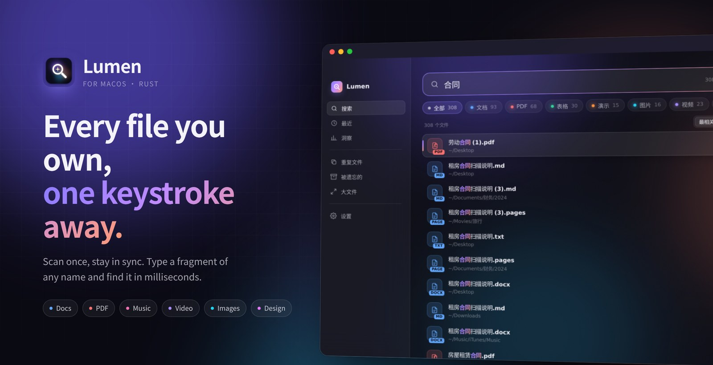
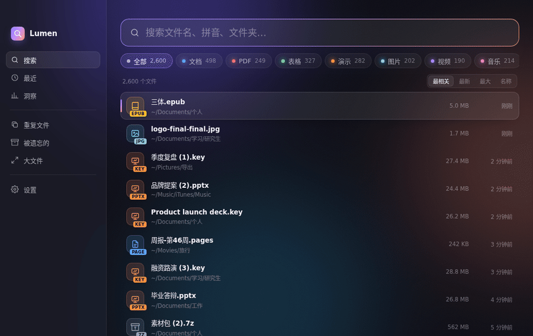
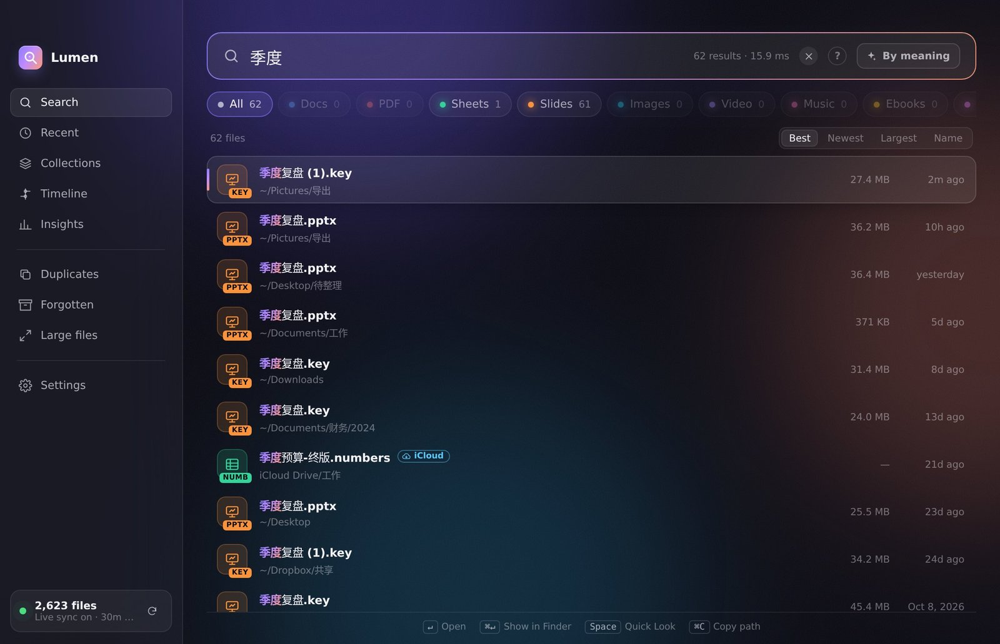
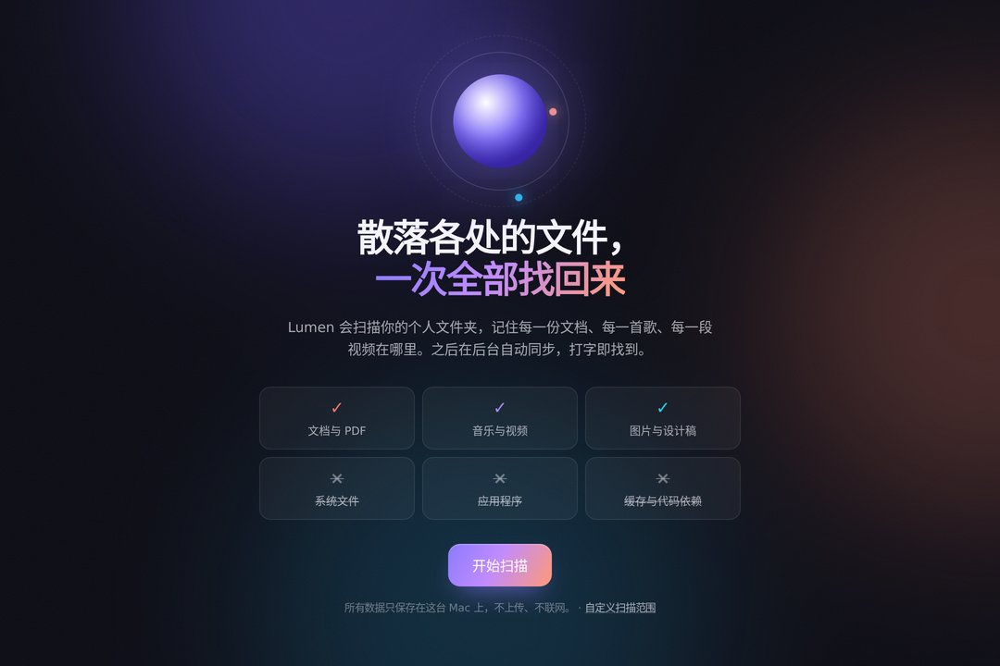
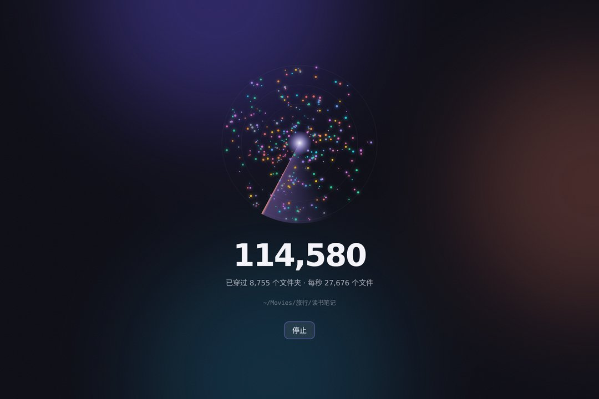
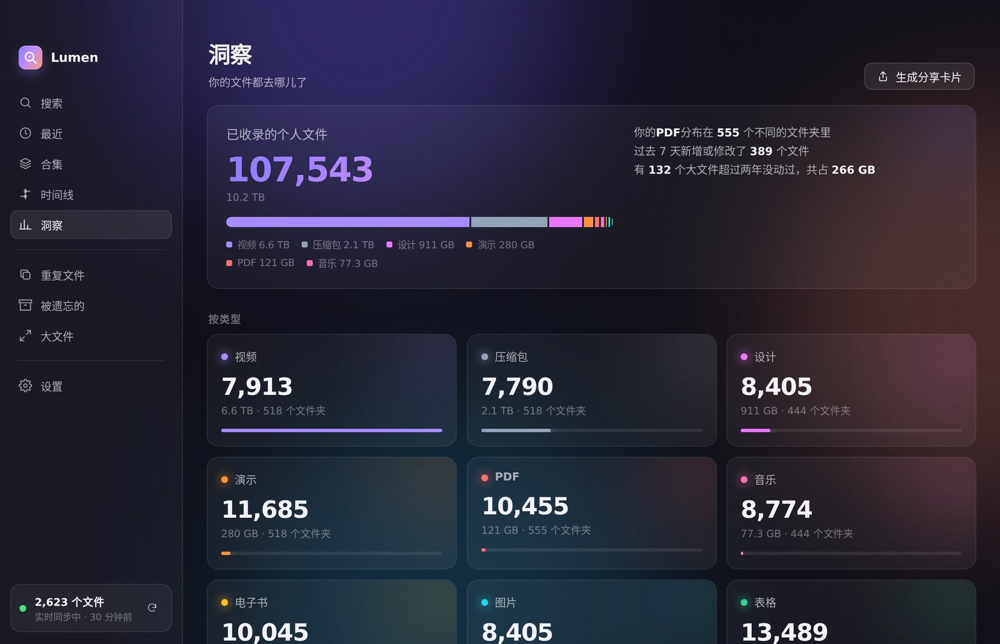
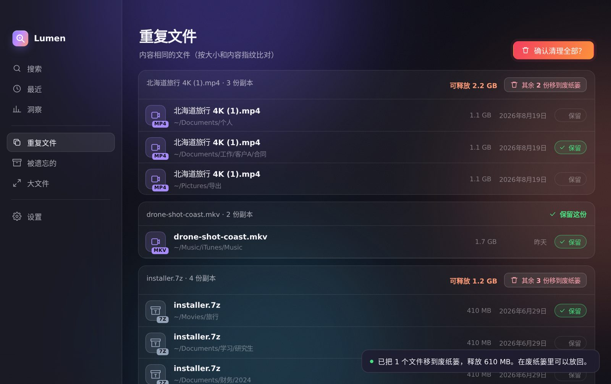

<p align="center">
  
</p>

<p align="center">
  <a href="README.md">简体中文</a> · <b>English</b>
</p>

<p align="center">
  
  
  
  
  
  
</p>

<h3 align="center">Remember two letters of the name? That's enough.<br>Lumen tells you where it is, in milliseconds.</h3>

<br>

<p align="center">
  
</p>

<br>

## ✦ New in v0.9: every cloud drive, accents optional

- **Cloud sync folders** — Dropbox, OneDrive, Google Drive, Box, Nutstore and any other sync app that lives in `~/Library/CloudStorage` are indexed; older `~/Dropbox`-style folders are labelled too. Each result carries a small badge with its service, files not downloaded to this Mac are still found, and Lumen never downloads a file to read, OCR or fingerprint it. Settings → Search powers → Cloud sync folders.
- **`cloud:` filter** — `cloud:dropbox`, `cloud:onedrive`, `cloud:any`, `cloud:none`.
- **Accents don't matter** — `resume` finds `Résumé.png`, `cafe` finds `Café`; pinyin and CJK search are unchanged, and existing indexes catch up in the background.
- **Fixes** — `lumen search … | head` no longer panics with "Broken pipe"; scanned PDFs OCR'd by older versions are labelled "in image"; the first duplicate check of many huge files can be stopped.

## ✦ New in v0.8: smoother and quieter

- **Search during the first scan** — after 2,000 files, "Start searching now"; the scan carries on in the background, and the done screen suggests searches made from your own files.
- **Background work that saves your battery** — document reading and OCR run at background priority and pause on battery, in Low Power Mode or when you press Pause.
- **Errors with a fix** — missing access, a stopped scan or a failed update each come with "Grant access" or "Retry"; a damaged index rebuilds itself.
- **What you open ranks first** — files opened from Lumen in the last 30 days lead their tier.
- **Custom skips** — folder names or `*.log`-style types in Settings.
- **Load-tested at 300,000 files** — keyword searches scan once, 2–20× faster on big indexes.

## ✦ New in v0.7: Lumen from anywhere, iCloud Drive

<p align="center">
  
</p>

- **Raycast and Alfred** — a Raycast extension (`integrations/raycast`) and an Alfred workflow (`Lumen.alfredworkflow` on every release): `lf annual review` by name, pinyin or contents, `la snow videos from Hokkaido` by meaning. ↵ open, ⌘↵ reveal in Finder, ⇧ Quick Look.
- **`lumen://` links** — `lumen://search?q=lease`, `lumen://ask?q=the lease I signed last year`, `lumen://quick?q=invoice` from Notes, a web page or a Shortcut's Open URL.
- **Shortcuts** — Open URL `lumen://search?q=…`, or Run Shell Script `lumen --json search invoice` to hand results to the next action.
- **The CLI ships in the app** — `Lumen.app/Contents/MacOS/lumen`; the Homebrew cask puts it on your PATH.
- **iCloud Drive** — files in iCloud Drive are searchable, even ones not downloaded (marked “iCloud”). Lumen never downloads a file just to read or fingerprint it.

## ✦ New in v0.6: search by meaning, Homebrew

<p align="center">
  
</p>

- **Search by meaning (beta)** — describe the file instead of remembering its name: "snow videos from Japan", "the lease I signed last year". Lumen uses the language model built into macOS to learn what each file is about; if a language model is missing, macOS downloads it from Apple once; your files never leave your Mac. Click ✦ in the search bar or press ⌘J.
- **Homebrew** — `brew tap lyinet/lumen-finder https://github.com/lyinet/lumen-finder && brew install --cask lumen-finder`

## ✦ New in v0.5: timeline, share card, in-app updates

- **Timeline** — every month of your files at a glance, with what each month was made of; open a month and filter by type.
- **Share card** — one click on Insights draws a portrait card of your Mac in files, saved to the Desktop.
- **In-app updates** — a banner when a new version ships; one click downloads, verifies the signature and relaunches. Nothing installs on its own, and checks can be switched off.

## ✦ New in v0.4: smart collections + text in images

- **Smart collections** — invoices & receipts, contracts, IDs, screenshots and résumés gather themselves from wherever they live.
- **OCR** — macOS Vision reads photos, screenshots and scanned PDFs (Chinese, English, Japanese, Korean) on device, so a photographed receipt is searchable by what it says.
- **Traditional Chinese UI** for zh-TW / zh-HK / zh-MO.

## ✦ New in v0.3: a Spotlight-style quick panel

<p align="center">
  
</p>

- **Quick panel** — `⌥ Space` pops a search box mid-screen: `↵` opens, `⌘↵` reveals, `⌘Y` Quick Look, `⌘O` hands the results to the main window. Click away to dismiss.
- **Faster, smaller text index** — CJK text is indexed as two-character pieces: two-character Chinese words went from 71 ms to **8 ms**, the index is **40% smaller**.
- **Open at login** — quietly in the menu bar.
- **Light, dark or follow the system.**

## ✦ New in v0.2: search what your files say

<p align="center">
  
</p>

- **Full-text search** — reads Word, PDF, Markdown, text, RTF, HTML, PowerPoint, Excel, OpenDocument and EPUB. Type a phrase you remember and get the file, with the matching line. On this Mac only.
- **External drives, even unplugged** — USB disks and SD cards are indexed; unplugged, their files stay searchable, marked "not connected". Plug back in and they resync.
- **Clean up duplicates** — pick the copy to keep, send the rest to the Trash (Put Back works), or clean everything at once.
- **Menu bar icon + custom hotkey** — record any shortcut to replace ⌥ Space; conflicts are caught.
- **Full Disk Access guide** — detected, one click to the right System Settings pane.

## ✦ Why Lumen

> Spotlight searches everything — mail, settings, web suggestions. Finder makes you wait.
> Lumen answers one question only: **where are my files.**

<table>
<tr>
<td width="33%" valign="top">

### ⚡ Scan once, stay in sync
A parallel walk indexes 120k files in **4.4 s**. FSEvents keeps it live; changes made while Lumen was closed are caught on launch.

</td>
<td width="33%" valign="top">

### 🔤 Substring search, any script
Trigram full-text index: any fragment matches, in English, Chinese (with pinyin and initials) or anything else.

</td>
<td width="33%" valign="top">

### 🧹 Only your files
System folders, Library, apps, `.app` / Photos packages, `node_modules`, `.git`, caches and dotfiles are skipped.

</td>
</tr>
<tr>
<td valign="top">

### ⌨️ Keyboard first
`⌥ Space` anywhere, `↑↓` to move, `↵` open, `⌘↵` show in Finder, `Space` Quick Look, `⌘C` copy path.

</td>
<td valign="top">

### 🔍 Filters in one line
`kind:pdf` `in:Downloads` `cloud:dropbox` `>100mb` `after:2024-03` `"exact phrase"` — mix freely. Accents optional: `resume` finds `Résumé`.

</td>
<td valign="top">

### 🔒 Fully offline
The index never leaves your Mac. No uploads, no telemetry; the only request is an update check you can switch off.

</td>
</tr>
</table>

## ✦ A look around

<table>
<tr>
<td width="50%"><p align="center"><sub><b>First run</b> — what's scanned, what's not</sub></p></td>
<td width="50%"><p align="center"><sub><b>Scan radar</b> — every dot is a file found</sub></p></td>
</tr>
<tr>
<td><p align="center"><sub><b>Insights</b> — how scattered are your videos?</sub></p></td>
<td><p align="center"><sub><b>Duplicates</b> — content fingerprints, sorted by space saved</sub></p></td>
</tr>
</table>

<sub>Screenshots show the UI preview with sample data.</sub>

## ✦ Install

**Homebrew**

```bash
brew tap lyinet/lumen-finder https://github.com/lyinet/lumen-finder
brew install --cask lumen-finder
```

Or download the DMG from [Releases](https://github.com/lyinet/lumen-finder/releases/latest) (not notarized yet: right-click → Open the first time). Later versions arrive as in-app updates.

**Build from source** (~3 minutes)

```bash
xcode-select --install
curl https://sh.rustup.rs -sSf | sh
cargo install tauri-cli --version "^2" --locked

git clone https://github.com/lyinet/lumen-finder.git && cd lumen-finder/app/src-tauri
cargo tauri dev                                       # run
cargo tauri build --target universal-apple-darwin     # .dmg for Apple Silicon + Intel
```

To index everything, allow Lumen under **System Settings → Privacy & Security → Full Disk Access**.

Preview the UI without Rust: `cd app/ui && python3 -m http.server 8765`, then open `http://localhost:8765/#first`.

## ✦ Architecture

```
app/ui              vanilla JS + CSS, no build step; mock data in a browser
app/src-tauri       Tauri 2 shell: commands, events, menu bar, hotkey, Trash, vibrancy
crates/lumen-core   engine: exclusion rules · parallel scan · SQLite WAL + FTS5 trigram
                    · pinyin · generational incremental · FSEvents · duplicates (BLAKE3)
                    · text extraction (docx/pptx/xlsx/pdf/epub/…) + content FTS · offline volumes
crates/lumen-cli    command line
```

See [docs/ARCHITECTURE.md](docs/ARCHITECTURE.md).

## ✦ Roadmap

- [x] Full scan + live sync, substring/pinyin search, filters, insights, duplicates
- [ ] Signed, notarized DMG
- [x] Homebrew cask <sub>v0.6</sub>
- [x] Menu bar icon · custom hotkey · Full Disk Access guide <sub>v0.2</sub>
- [x] Offline external drives <sub>v0.2</sub>
- [x] Move duplicates to Trash <sub>v0.2</sub>
- [x] **Content search** for PDF / Word / Markdown / PowerPoint / Excel / EPUB <sub>v0.2</sub>
- [x] Image and scanned-PDF **OCR** (on-device Apple Vision) <sub>v0.4</sub>
- [x] Quick panel · open at login · light theme · faster CJK text index <sub>v0.3</sub>
- [x] In-app auto-update · timeline · share card <sub>v0.5</sub>
- [x] Smart collections: invoices, contracts, IDs, screenshots, résumés <sub>v0.4</sub>
- [x] On-device semantic search <sub>v0.6 beta</sub>

<br>

<p align="center"><sub>MIT License · Made with Rust 🦀</sub></p>
