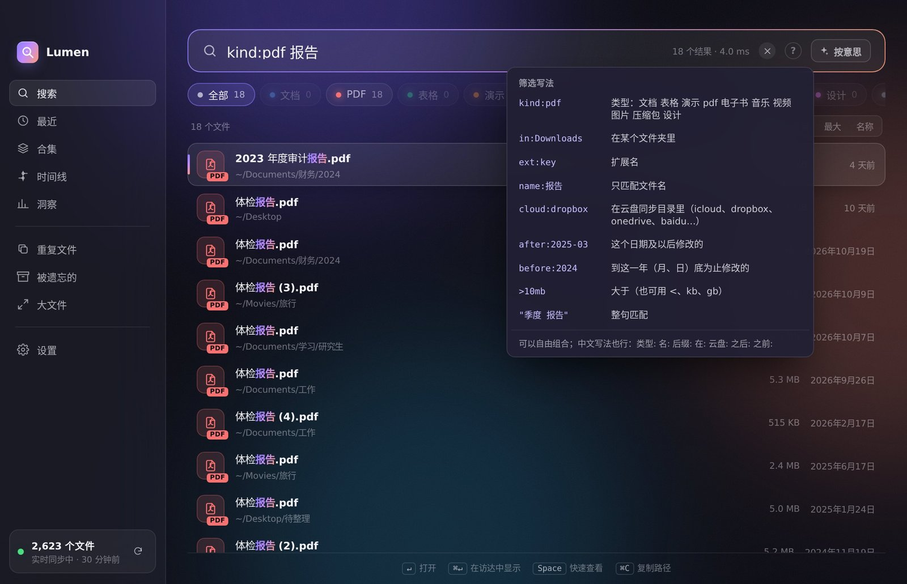
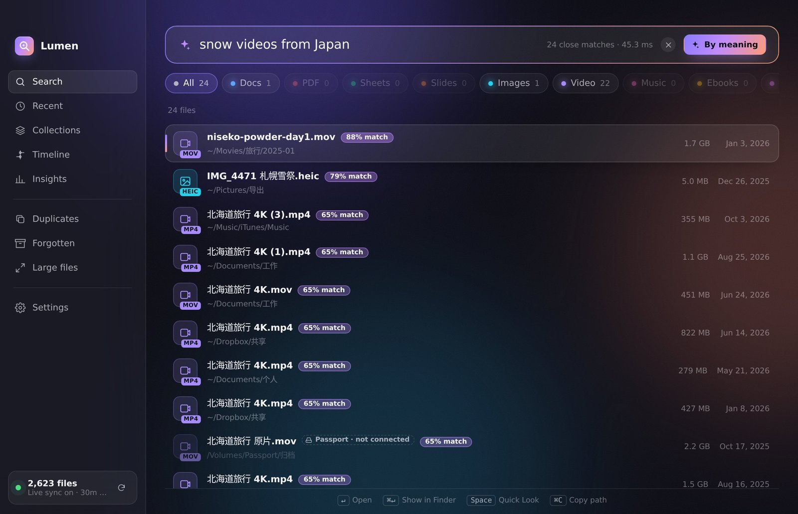
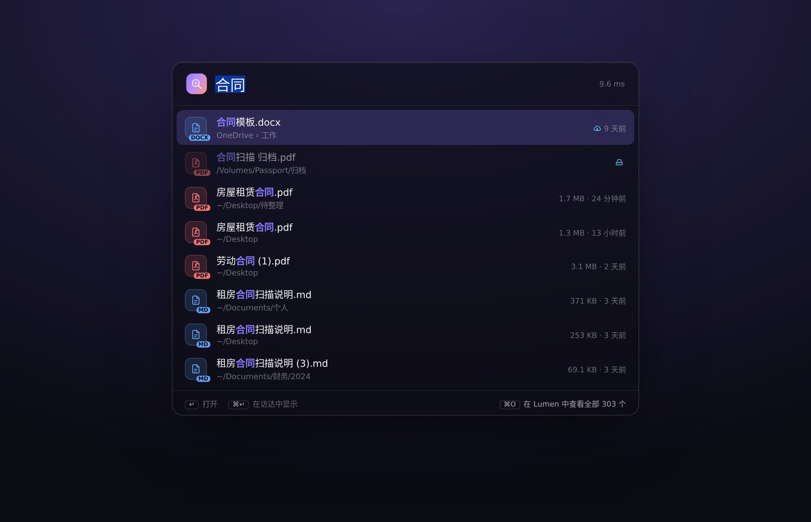
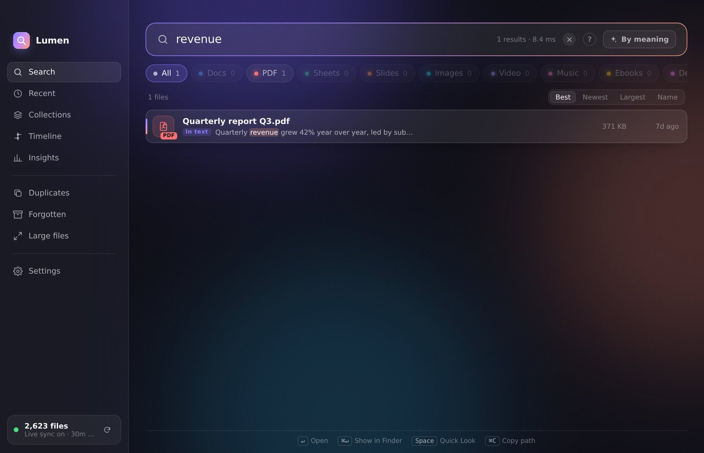

<p align="center">
  
</p>

<p align="center">
  <a href="README.md">简体中文</a> · <b>English</b>
</p>

<p align="center">
  
  
  
  
  
  
</p>

<h3 align="center">Remember two letters of the name? That's enough.<br>Lumen tells you where it is, in milliseconds.</h3>

<br>

<p align="center">
  
</p>

<br>

## ✦ New in v0.9: every cloud drive, accents optional

- **Cloud sync folders** — Dropbox, OneDrive, Google Drive, Box, Nutstore and any other sync app that lives in `~/Library/CloudStorage` are indexed; older `~/Dropbox`-style folders are labelled too. Each result carries a small badge with its service, files not downloaded to this Mac are still found, and Lumen never downloads a file to read, OCR or fingerprint it. Settings → Search powers → Cloud sync folders.
- **`cloud:` filter** — `cloud:dropbox`, `cloud:onedrive`, `cloud:any`, `cloud:none`.
- **Accents don't matter** — `resume` finds `Résumé.png`, `cafe` finds `Café`; pinyin and CJK search are unchanged, and existing indexes catch up in the background.
- **Fixes** — `lumen search … | head` no longer panics with "Broken pipe"; scanned PDFs OCR'd by older versions are labelled "in image"; the first duplicate check of many huge files can be stopped.

<table>
<tr>
<td width="50%"><p align="center"><sub><b>Cloud sync folders</b> — every result shows its service, downloaded or not</sub></p></td>
<td width="50%"><p align="center"><sub><b>Filter cheat-sheet</b> — click ? in the search bar; click a row to add it</sub></p></td>
</tr>
</table>

## ✦ New in v0.8: smoother and quieter

- **Search during the first scan** — after 2,000 files, "Start searching now"; the scan carries on in the background, and the done screen suggests searches made from your own files.
- **Background work that saves your battery** — document reading and OCR run at background priority and pause on battery, in Low Power Mode or when you press Pause.
- **Errors with a fix** — missing access, a stopped scan or a failed update each come with "Grant access" or "Retry"; a damaged index rebuilds itself.
- **What you open ranks first** — files opened from Lumen in the last 30 days lead their tier.
- **Custom skips** — folder names or `*.log`-style types in Settings.
- **Load-tested at 300,000 files** — keyword searches scan once, 2–20× faster on big indexes.

## ✦ New in v0.7: Lumen from anywhere, iCloud Drive

<p align="center">
  
</p>

- **Raycast and Alfred** — a Raycast extension (`integrations/raycast`) and an Alfred workflow (`Lumen.alfredworkflow` on every release): `lf annual review` by name, pinyin or contents, `la snow videos from Hokkaido` by meaning. ↵ open, ⌘↵ reveal in Finder, ⇧ Quick Look.
- **`lumen://` links** — `lumen://search?q=lease`, `lumen://ask?q=the lease I signed last year`, `lumen://quick?q=invoice` from Notes, a web page or a Shortcut's Open URL.
- **Shortcuts** — Open URL `lumen://search?q=…`, or Run Shell Script `lumen --json search invoice` to hand results to the next action.
- **The CLI ships in the app** — `Lumen.app/Contents/MacOS/lumen`; the Homebrew cask puts it on your PATH.
- **iCloud Drive** — files in iCloud Drive are searchable, even ones not downloaded (marked “iCloud”). Lumen never downloads a file just to read or fingerprint it.

## ✦ New in v0.6: search by meaning, Homebrew

<p align="center">
  
</p>

- **Search by meaning (beta)** — describe the file instead of remembering its name: "snow videos from Japan", "the lease I signed last year". Lumen uses the language model built into macOS to learn what each file is about; if a language model is missing, macOS downloads it from Apple once; your files never leave your Mac. Click ✦ in the search bar or press ⌘J.
- **Homebrew** — `brew tap lyinet/lumen-finder https://github.com/lyinet/lumen-finder && brew install --cask lumen-finder`

## ✦ New in v0.5: timeline, share card, in-app updates

- **Timeline** — every month of your files at a glance, with what each month was made of; open a month and filter by type.
- **Share card** — one click on Insights draws a portrait card of your Mac in files, saved to the Desktop.
- **In-app updates** — a banner when a new version ships; one click downloads, verifies the signature and relaunches. Nothing installs on its own, and checks can be switched off.

## ✦ New in v0.4: smart collections + text in images

- **Smart collections** — invoices & receipts, contracts, IDs, screenshots and résumés gather themselves from wherever they live.
- **OCR** — macOS Vision reads photos, screenshots and scanned PDFs (Chinese, English, Japanese, Korean) on device, so a photographed receipt is searchable by what it says.
- **Traditional Chinese UI** for zh-TW / zh-HK / zh-MO.

## ✦ New in v0.3: a Spotlight-style quick panel

<p align="center">
  
</p>

- **Quick panel** — `⌥ Space` pops a search box mid-screen: `↵` opens, `⌘↵` reveals, `⌘Y` Quick Look, `⌘O` hands the results to the main window. Click away to dismiss.
- **Faster, smaller text index** — CJK text is indexed as two-character pieces: two-character Chinese words went from 71 ms to **8 ms**, the index is **40% smaller**.
- **Open at login** — quietly in the menu bar.
- **Light, dark or follow the system.**

## ✦ New in v0.2: search what your files say

<p align="center">
  
</p>

- **Full-text search** — reads Word, PDF, Markdown, text, RTF, HTML, PowerPoint, Excel, OpenDocument and EPUB. Type a phrase you remember and get the file, with the matching line. On this Mac only.
- **External drives, even unplugged** — USB disks and SD cards are indexed; unplugged, their files stay searchable, marked "not connected". Plug back in and they resync.
- **Clean up duplicates** — pick the copy to keep, send the rest to the Trash (Put Back works), or clean everything at once.
- **Menu bar icon + custom hotkey** — record any shortcut to replace ⌥ Space; conflicts are caught.
- **Full Disk Access guide** — detected, one click to the right System Settings pane.

## ✦ Why Lumen

> Spotlight searches everything — mail, settings, web suggestions. Finder makes you wait.
> Lumen answers one question only: **where are my files.**

<table>
<tr>
<td width="33%" valign="top">

### ⚡ Scan once, stay in sync
A parallel walk indexes 120k files in **4.4 s**. FSEvents keeps it live; changes made while Lumen was closed are caught on launch.

</td>
<td width="33%" valign="top">

### 🔤 Substring search, any script
Trigram full-text index: any fragment matches, in English, Chinese (with pinyin and initials) or anything else.

</td>
<td width="33%" valign="top">

### 🧹 Only your files
System folders, Library, apps, `.app` / Photos packages, `node_modules`, `.git`, caches and dotfiles are skipped.

</td>
</tr>
<tr>
<td valign="top">

### ⌨️ Keyboard first
`⌥ Space` anywhere, `↑↓` to move, `↵` open, `⌘↵` show in Finder, `Space` Quick Look, `⌘C` copy path.

</td>
<td valign="top">

### 🔍 Filters in one line
`kind:pdf` `in:Downloads` `cloud:dropbox` `>100mb` `after:2024-03` `"exact phrase"` — mix freely. Accents optional: `resume` finds `Résumé`.

</td>
<td valign="top">

### 🔒 Fully offline
The index never leaves your Mac. No uploads, no telemetry; the only request is an update check you can switch off.

</td>
</tr>
</table>

## ✦ A look around

<table>
<tr>
<td width="50%"><p align="center"><sub><b>First run</b> — what's scanned, what's not</sub></p></td>
<td width="50%"><p align="center"><sub><b>Scan radar</b> — every dot is a file found</sub></p></td>
</tr>
<tr>
<td><p align="center"><sub><b>Insights</b> — how scattered are your videos?</sub></p></td>
<td><p align="center"><sub><b>Duplicates</b> — content fingerprints, sorted by space saved</sub></p></td>
</tr>
</table>

<sub>Screenshots show the UI preview with sample data.</sub>

## ✦ Search syntax

| Write | Means |
|---|---|
| `invoice` `résumé` | Name or folder contains it; also matches document text; accents optional (`resume` finds `Résumé`). Chinese names also match pinyin: `hetong` `ht` |
| `name:invoice` | File name only, not the text inside |
| `kind:pdf` | Type: `doc` · `sheet` · `slides` · `pdf` · `ebook` · `music` · `video` · `image` · `zip` · `design` |
| `ext:key` | File extension |
| `in:Downloads` | Path contains |
| `cloud:dropbox` | Files in a cloud drive: `icloud` `dropbox` `onedrive` `gdrive` `box` `baidu` `nutstore`, or any folder name in `~/Library/CloudStorage`; `cloud:any` all of them, `cloud:none` none |
| `>100mb` `<2gb` | Size (`kb` `mb` `gb` `tb`) |
| `after:2024-03` `before:2025` | Modified on/after that date; up to the end of that year, month or day |
| `"meeting notes"` | Exact phrase |

Aliases: `type:` / `is:` = `kind:`, `folder:` = `in:`, `since:` = `after:`, `until:` = `before:`. Chinese keys work too: `类型:` `名:` `后缀:` `在:` `云盘:` `之后:` `之前:` (Traditional: `類型:` `檔名:` `副檔名:` `雲端:` `之後:`). The **?** button in the search bar shows this list.

## ✦ Install

**Homebrew (recommended)**

```bash
brew tap lyinet/lumen-finder https://github.com/lyinet/lumen-finder
brew install --cask lumen-finder
```

Or download the DMG from [Releases](https://github.com/lyinet/lumen-finder/releases/latest). It is not notarized yet, so the first time macOS blocks it: go to **System Settings → Privacy & Security** and click **Open Anyway** (details in the [FAQ](#-faq)). Homebrew avoids this step. Later versions arrive as in-app updates. Requires macOS 11 or later.

**Build from source** (~5 minutes, macOS 11+, Xcode Command Line Tools)

```bash
xcode-select --install
curl https://sh.rustup.rs -sSf | sh
cargo install tauri-cli --version "^2" --locked
git clone https://github.com/lyinet/lumen-finder.git && cd lumen-finder
```

The app bundles two helper binaries (`externalBin` in `tauri.conf.json`) that are not in the repo: `lumen-ocr` (Apple Vision OCR and sentence embeddings, Swift) and `lumen` (the CLI). Build them into `app/src-tauri/binaries/` first, named with the target triple, exactly as CI does.

For your own Mac (`cargo tauri dev` or a single-architecture build):

```bash
T=$(rustc -vV | sed -n 's/^host: //p')          # aarch64-apple-darwin or x86_64-apple-darwin
mkdir -p app/src-tauri/binaries
swiftc -O -target "$(uname -m)-apple-macos11" app/ocr/main.swift -o "app/src-tauri/binaries/lumen-ocr-$T"
cargo build --release -p lumen-cli
cp target/release/lumen "app/src-tauri/binaries/lumen-$T"

cd app/src-tauri
cargo tauri dev                                  # run
cargo tauri build --config '{"bundle":{"createUpdaterArtifacts":false}}'   # .app + .dmg
```

Universal build (Apple Silicon + Intel), as in `.github/workflows/build.yml`:

```bash
rustup target add aarch64-apple-darwin x86_64-apple-darwin
mkdir -p app/src-tauri/binaries
for arch in arm64 x86_64; do
  swiftc -O -target $arch-apple-macos11 app/ocr/main.swift -o /tmp/lumen-ocr-$arch
done
lipo -create /tmp/lumen-ocr-arm64 /tmp/lumen-ocr-x86_64 -output /tmp/lumen-ocr
for t in aarch64-apple-darwin x86_64-apple-darwin; do
  cargo build --release -p lumen-cli --target $t
done
lipo -create target/aarch64-apple-darwin/release/lumen target/x86_64-apple-darwin/release/lumen -output /tmp/lumen
for t in universal-apple-darwin aarch64-apple-darwin x86_64-apple-darwin; do
  cp /tmp/lumen-ocr app/src-tauri/binaries/lumen-ocr-$t
  cp /tmp/lumen app/src-tauri/binaries/lumen-$t
done
cd app/src-tauri
cargo tauri build --target universal-apple-darwin --config '{"bundle":{"createUpdaterArtifacts":false}}'
```

`createUpdaterArtifacts:false` skips the signed update archive, which needs the project's private updater key (`TAURI_SIGNING_PRIVATE_KEY`). Without an Apple certificate, set `APPLE_SIGNING_IDENTITY=-` for an ad-hoc signature like the released builds.

To index everything, allow Lumen under **System Settings → Privacy & Security → Full Disk Access**.

Preview the UI without Rust: `cd app/ui && python3 -m http.server 8765`, then open `http://localhost:8765/#first`.

## ✦ FAQ

<details>
<summary><b>macOS says Lumen “can’t be opened” or “Apple could not verify” it</b></summary>

Lumen is not notarized by Apple yet. Install with Homebrew to skip this (the cask clears the download quarantine). With the DMG: drag Lumen to Applications and open it once. When macOS refuses, click **Done**, then open **System Settings → Privacy & Security**, scroll to **Security**, and click **Open Anyway** next to the message about Lumen (it appears for about an hour after you tried). Confirm with your password or Touch ID. You only do this once; in-app updates open normally. On macOS 14 and earlier, Control-click → Open also works.
</details>

<details>
<summary><b>Full Disk Access: why, and what to do after an update</b></summary>

Without it, macOS asks separately for Desktop, Documents, Downloads, iCloud Drive and removable drives, and some folders are skipped. Open **System Settings → Privacy & Security → Full Disk Access** and turn Lumen on; if Lumen is not in the list, click **+** (or drag it in from Applications). Lumen’s Settings has a button that opens this page and a guide.

Because Lumen is not signed with an Apple Developer ID yet, macOS may treat an updated Lumen as a new app. If Lumen asks for access again after an update, or folders are missing, select Lumen in the Full Disk Access list, remove it with **–**, add it again with **+**, and reopen Lumen.
</details>

<details>
<summary><b>Where are the logs?</b></summary>

`~/Library/Logs/app.lumen.desktop/Lumen.log`. **Settings → Log file → Show Log in Finder** selects it for you. It records what Lumen did and any errors, and can include file and folder paths, so look it over before attaching it to an issue.
</details>

<details>
<summary><b>How do I uninstall Lumen completely?</b></summary>

Homebrew: `brew uninstall --zap --cask lumen-finder` removes the app, the `lumen` command and everything below.

By hand: turn off **Settings → Open at login**, quit Lumen from the menu bar, move Lumen from Applications to the Trash, then delete:

| Path | What |
|---|---|
| `~/Library/Application Support/app.lumen.desktop` | index (`index.db`) and settings (`config.json`) |
| `~/Library/Logs/app.lumen.desktop` | log |
| `~/Library/Caches/app.lumen.desktop` | caches |
| `~/Library/WebKit/app.lumen.desktop` | web view data |
| `~/Library/Preferences/app.lumen.desktop.plist` | macOS preferences |
| `~/Library/LaunchAgents/Lumen.plist` | open-at-login entry (only if it was on) |

Lumen never changes your files, so nothing else needs cleaning up.
</details>

<details>
<summary><b>Does Lumen use the network?</b></summary>

Only to check for updates: it reads a small `latest.json` from this repository’s GitHub Releases, and downloads an update only when you click Install. Turn it off under **Settings → Check for updates**. No telemetry, no analytics, and your files and index never leave the Mac. Separately, when search by meaning is on (macOS 14+), macOS may download Apple’s on-device language model once; that download comes from macOS itself.
</details>

## ✦ Architecture

```
app/ui              vanilla JS + CSS, no build step; mock data in a browser
app/src-tauri       Tauri 2 shell: commands, events, menu bar, hotkey, Trash, vibrancy
crates/lumen-core   engine: exclusion rules · parallel scan · SQLite WAL + FTS5 trigram
                    · pinyin · generational incremental · FSEvents · duplicates (BLAKE3)
                    · text extraction (docx/pptx/xlsx/pdf/epub/…) + content FTS · offline volumes
crates/lumen-cli    command line
```

See [docs/ARCHITECTURE.md](docs/ARCHITECTURE.md).

## ✦ Roadmap

- [x] Full scan + live sync, substring/pinyin search, filters, insights, duplicates
- [ ] Signed, notarized DMG
- [x] Homebrew cask <sub>v0.6</sub>
- [x] Menu bar icon · custom hotkey · Full Disk Access guide <sub>v0.2</sub>
- [x] Offline external drives <sub>v0.2</sub>
- [x] Move duplicates to Trash <sub>v0.2</sub>
- [x] **Content search** for PDF / Word / Markdown / PowerPoint / Excel / EPUB <sub>v0.2</sub>
- [x] Image and scanned-PDF **OCR** (on-device Apple Vision) <sub>v0.4</sub>
- [x] Quick panel · open at login · light theme · faster CJK text index <sub>v0.3</sub>
- [x] In-app auto-update · timeline · share card <sub>v0.5</sub>
- [x] Smart collections: invoices, contracts, IDs, screenshots, résumés <sub>v0.4</sub>
- [x] On-device semantic search <sub>v0.6 beta</sub>

<br>

<p align="center"><sub>MIT License · Made with Rust 🦀</sub></p>
