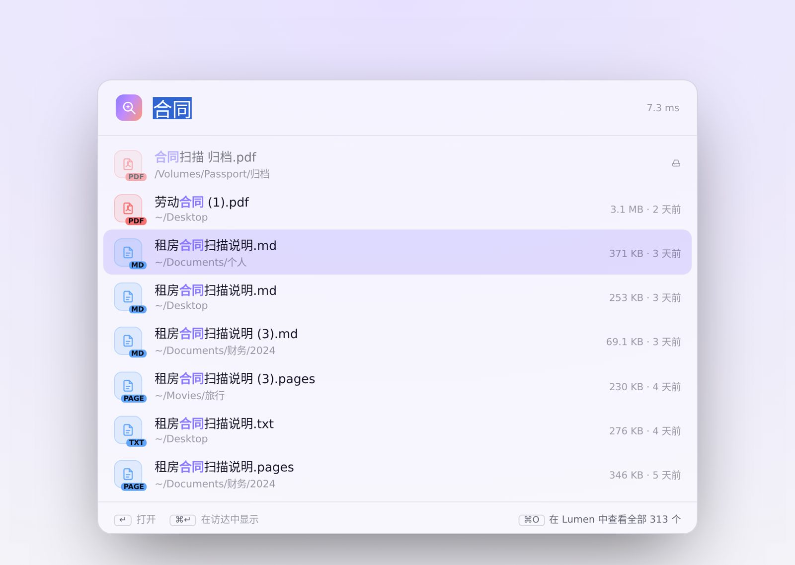
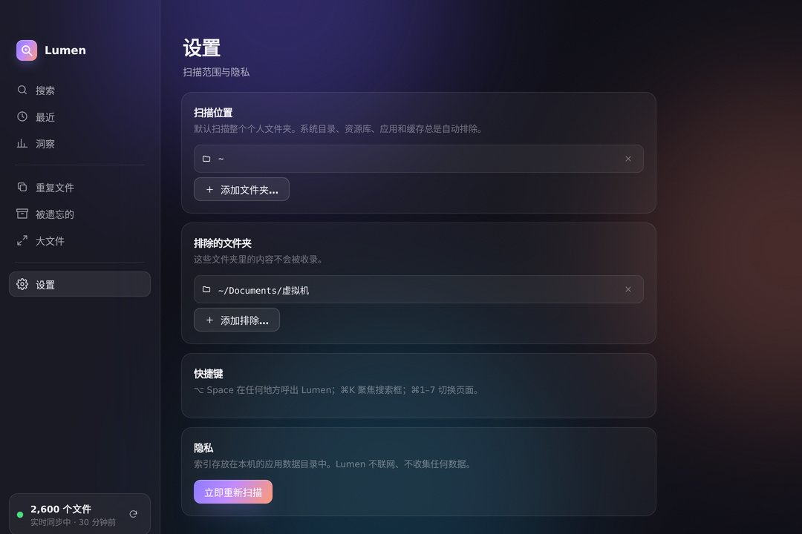
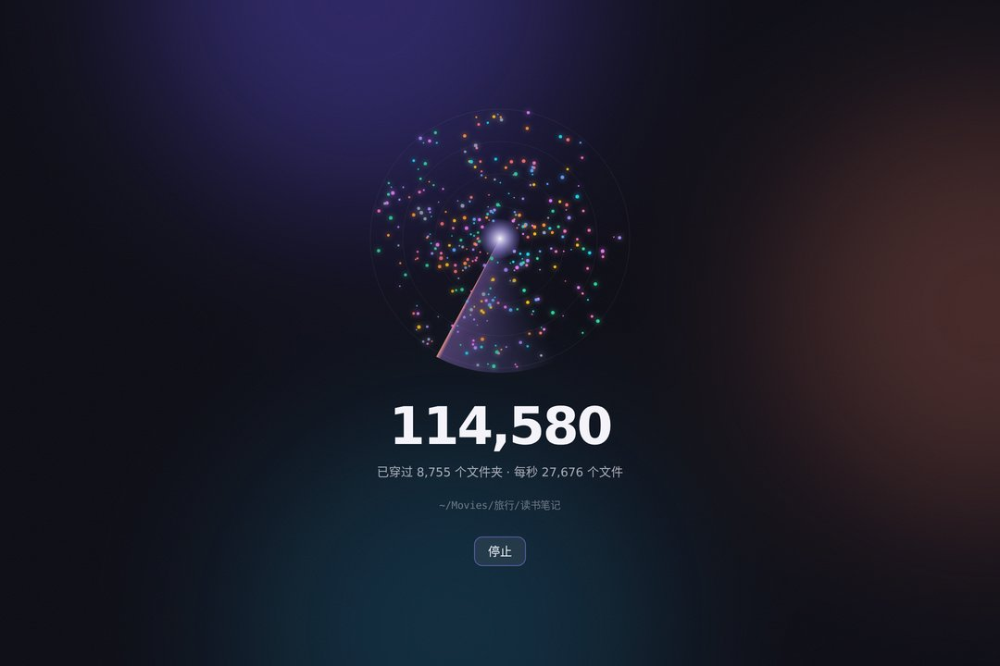
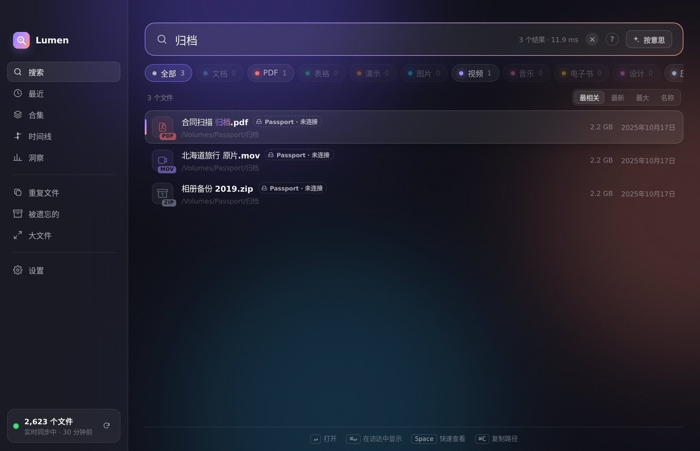

<p align="center">
  
</p>

<p align="center">
  <b>简体中文</b> · <a href="README.en.md">English</a>
</p>

<p align="center">
  
  
  
  
  
  
</p>

<h3 align="center">只记得名字里的两个字？拼音首字母也行。<br>连名字都忘了？说一句文件里写过的话。</h3>

<br>

<p align="center">
  
</p>

<br>

## ✦ v0.3 新增：像 Spotlight 一样随手一搜

<p align="center">
  
</p>

- **快速搜索小窗** — 按 `⌥ Space`，屏幕中间弹出搜索框；`↵` 打开，`⌘↵` 在访达中显示，`⌘Y` 快速查看，`⌘O` 把全部结果交给主窗口。点别处自动收起。
- **正文索引重写** — 中文按二字切分建索引：「合同」这类两字词从 71 ms 降到 **8 ms**，索引体积缩小 **40%**，首次读取快 25%。
- **开机启动** — 登录后安静待在菜单栏，不弹窗。
- **浅色 / 深色 / 跟随系统** — 可在设置里固定外观。

<table>
<tr>
<td width="50%"><p align="center"><sub><b>浅色外观</b> · 小窗</sub></p></td>
<td width="50%"><p align="center"><sub><b>浅色外观</b> · 主窗口</sub></p></td>
</tr>
</table>

## ✦ v0.2 新增：搜文件里写了什么

<p align="center">
  
</p>

- **正文搜索** — 读取 Word、PDF、Markdown、TXT、RTF、HTML、PPT、Excel、OpenDocument、EPUB 里的文字。输入"合同期限"，直接定位到写了这句话的审计报告，并显示原文片段。老 Windows 的 GBK 文本也能读。全部本机处理。
- **外置硬盘离线索引** — 移动硬盘、U 盘自动收录；拔掉后文件照样搜得到，标注「Passport · 未连接」。插回自动补扫。
- **重复文件一键清理** — 每组选一份保留，其余移到废纸篓（可在废纸篓"放回"），或一键清理全部。
- **菜单栏图标 + 自定义快捷键** — 点菜单栏随时呼出；在设置里录制任意组合键替换 ⌥ Space，冲突时提示。
- **完全磁盘访问引导** — 检测权限，一键跳到系统设置，避免逐个文件夹弹窗和漏扫。

<table>
<tr>
<td width="50%"><p align="center"><sub><b>重复文件</b> · 选保留哪份，其余进废纸篓</sub></p></td>
<td width="50%"><p align="center"><sub><b>设置</b> · 权限引导、正文搜索、外置硬盘、快捷键</sub></p></td>
</tr>
</table>

## ✦ 为什么是 Lumen

> Spotlight 什么都搜，结果里混着邮件、设置和网页建议；Finder 搜索要等，也不认拼音。
> Lumen 只回答一个问题：**你自己的文件在哪。**

<table>
<tr>
<td width="33%" valign="top">

### ⚡ 一次扫描，永远同步
并行遍历个人文件夹，12 万文件 **4.4 秒**建好索引。之后通过 FSEvents 实时增量，关机期间的变化启动时自动补齐。

</td>
<td width="33%" valign="top">

### 🀄 懂中文的搜索
任意子串匹配，`合同` 能找到《劳动合同扫描件》；**全拼** `hetong`、**首字母** `nzzj` 都行。

</td>
<td width="33%" valign="top">

### 🧹 只收你的文件
自动排除系统目录、资源库、应用、`.app`/照片图库、`node_modules`、`.git`、缓存与隐藏文件。

</td>
</tr>
<tr>
<td valign="top">

### ⌨️ 键盘优先
`⌥ Space` 全局呼出，`↑↓` 选择，`↵` 打开，`⌘↵` 在访达中显示，`Space` 快速查看，`⌘C` 复制路径。

</td>
<td valign="top">

### 🔍 一行筛选
`kind:pdf` `类型:视频` `in:Downloads` `>100mb` `after:2024-03` `"精确短语"`，自由组合。

</td>
<td valign="top">

### 🔒 完全离线
索引只存在你的 Mac 上。不联网、不上传、不收集任何数据。

</td>
</tr>
</table>

## ✦ 看一看

<table>
<tr>
<td width="50%"><p align="center"><sub><b>首次启动</b> · 扫什么、不扫什么，一眼看清</sub></p></td>
<td width="50%"><p align="center"><sub><b>扫描雷达</b> · 每个光点是一类被找到的文件</sub></p></td>
</tr>
<tr>
<td><p align="center"><sub><b>洞察</b> · 你的视频散落在多少个文件夹里？</sub></p></td>
<td><p align="center"><sub><b>外置硬盘</b> · 拔掉也能搜到，标注未连接</sub></p></td>
</tr>
</table>

<sub>截图为界面预览（模拟数据）。</sub>

## ✦ 搜索语法

| 写法 | 含义 |
|---|---|
| `合同` `hetong` `ht` | 名称或文件夹包含；拼音全拼 / 首字母；也匹配文档正文 |
| `name:合同` | 只匹配文件名，不搜正文 |
| `kind:pdf` `类型:音乐` | 按类型：文档 · 表格 · 演示 · PDF · 电子书 · 音乐 · 视频 · 图片 · 压缩包 · 设计 |
| `ext:key` | 按扩展名 |
| `in:Downloads` | 路径中包含 |
| `>100mb` `<2gb` | 按大小 |
| `after:2024-03` `before:2025` | 按修改时间 |
| `"meeting notes"` | 精确短语 |

## ✦ 安装

> 首个签名版本发布前，请从源码构建（约 3 分钟）。

```bash
xcode-select --install
curl https://sh.rustup.rs -sSf | sh
cargo install tauri-cli --version "^2" --locked

git clone https://github.com/lyinet/lumen-finder.git && cd lumen-finder/app/src-tauri
cargo tauri dev                                       # 开发运行
cargo tauri build --target universal-apple-darwin     # 打包 .dmg（Apple Silicon + Intel）
```

想一次扫全，请在 **系统设置 → 隐私与安全性 → 完全磁盘访问权限** 中允许 Lumen。

<details>
<summary><b>不装 Rust，先在浏览器里看界面</b></summary>

```bash
cd app/ui && python3 -m http.server 8765
# 打开 http://localhost:8765/#first   （#insights  #dupes  #q=合同）
```
</details>

<details>
<summary><b>命令行</b>（与 App 共用索引）</summary>

```bash
cargo run -p lumen-cli -- scan ~          # 扫描后自动读取正文
cargo run -p lumen-cli -- search 合同 kind:pdf
cargo run -p lumen-cli -- stats
cargo run -p lumen-cli -- dupes
```
</details>

## ✦ 架构

```
app/ui              原生 JS + CSS，零构建；浏览器中自动使用模拟数据
app/src-tauri       Tauri 2 外壳：命令、事件、菜单栏、可改快捷键、废纸篓、毛玻璃窗口
crates/lumen-core   引擎：排除规则 · 并行扫描 · SQLite WAL + FTS5 trigram
                    · 拼音索引 · 增量（generation）· FSEvents 监听 · 重复文件（BLAKE3）
                    · 正文提取（docx/pptx/xlsx/pdf/epub/…）+ 正文 FTS · 外置卷离线保留
crates/lumen-cli    命令行
```

设计取舍与性能数据见 [docs/ARCHITECTURE.md](docs/ARCHITECTURE.md)。

## ✦ 路线图

- [x] 全盘扫描 + 实时增量、中文/拼音搜索、筛选语法、洞察、重复文件
- [ ] 签名公证 DMG + 自动更新 · Homebrew cask
- [x] 菜单栏入口 · 自定义呼出快捷键 · 完全磁盘访问引导 <sub>v0.2</sub>
- [x] 外置硬盘离线索引（"Passport · 未连接"）<sub>v0.2</sub>
- [x] 重复文件一键移到废纸篓 <sub>v0.2</sub>
- [x] **正文搜索** PDF / Word / Markdown / PPT / Excel / EPUB <sub>v0.2</sub>
- [ ] 图片与扫描件 **OCR**（本地 Apple Vision）
- [x] 快速搜索小窗 · 开机自启 · 浅色主题 · 二字词正文索引 <sub>v0.3</sub>
- [ ] 应用内自动更新 · Homebrew
- [ ] 智能合集：发票、合同、证件照、截图
- [ ] 本地语义搜索："北海道的雪景视频"

完整计划见 [docs/PRODUCT.md](docs/PRODUCT.md)。

## ✦ 参与

欢迎 Issue 和 PR。引擎测试在 Linux / macOS 都能跑：

```bash
cargo test --workspace
```

<br>

<p align="center"><sub>MIT License · Made with Rust 🦀 and a lot of 毛玻璃</sub></p>
