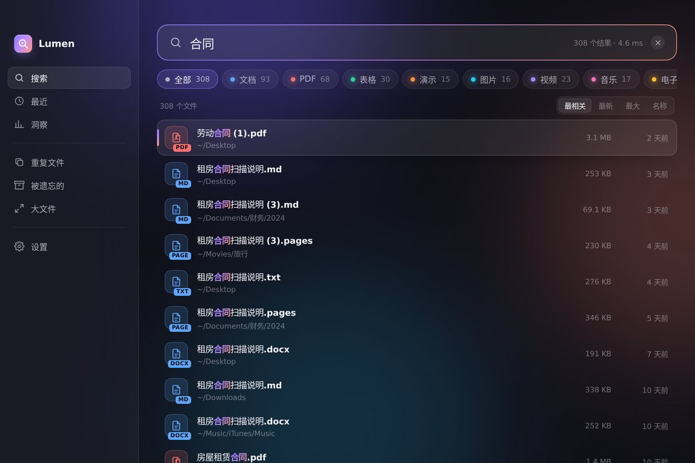
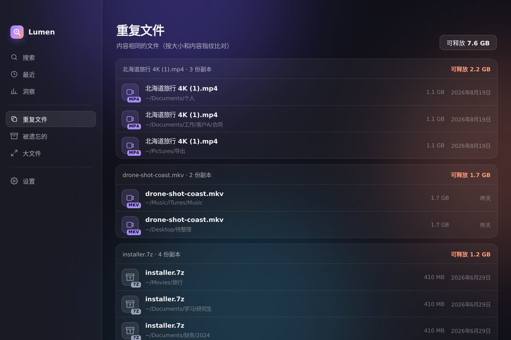

# Lumen

**散落各处的文件，一次全部找回来。**
Lumen 是一个 macOS 原生桌面应用：扫描一次你的个人文件（文档、PDF、表格、演示、音乐、视频、图片、电子书、设计稿、压缩包），之后在后台通过 FSEvents 实时增量同步。你只需要记得文件名里的一两个字，甚至只记得拼音首字母，就能在几十毫秒内找到它在哪。



## 为什么做它

Spotlight 什么都搜（邮件、设置、网页建议），结果杂；Finder 搜索慢、不支持拼音；EasyFind / Find Any File 能用但难看。Lumen 只做一件事：**你自己的文件在哪**，并把这件事做到又快又漂亮。

## 功能（v0.1）

| | |
|---|---|
| **一次扫描** | 并行遍历整个个人文件夹，自动排除系统目录、资源库、应用、`.app`/照片图库等包、`node_modules`/`.git`/缓存、隐藏文件。实测 12 万文件目录 4.4 秒建好索引（2 核沙盒）。 |
| **增量同步** | 运行时用 FSEvents 实时更新（0.7 秒合并一次事件）；启动时做一次增量扫描，补上关闭期间的变化，只改动变化过的行。 |
| **中文友好的搜索** | FTS5 trigram 全文索引，任意子串匹配；中文 2 字词自动走兜底；**全拼和首字母**（`hetong`、`nzzj`）都能搜。 |
| **筛选语法** | `kind:pdf` `类型:视频` `ext:key` `in:Downloads` `>100mb` `<2gb` `after:2024-03` `before:2025` `"精确短语"`，可随意组合。 |
| **类型筛选条** | 每个类型实时显示命中数，⌘/⇧ 点击多选。 |
| **键盘优先** | ⌥Space 全局呼出，↑↓ 选择，↵ 打开，⌘↵ 在访达中显示，Space 快速查看，⌘C 复制路径，⌘1–7 切换页面。 |
| **洞察** | 每种文件占多少空间、散落在多少个文件夹、最近 7 天变化、两年没动过的大文件。 |
| **重复文件** | 同大小 → 采样 BLAKE3 指纹，按可释放空间排序。 |
| **隐私** | 索引只存在本机，不联网、不收集数据。 |

## 截图

| 首次启动 | 扫描中 | 扫描完成 |
|---|---|---|
|  |  |  |
| **洞察** | **重复文件** | **设置** |
|  |  |  |

## 构建（在 Mac 上）

```bash
# 1. 工具链
xcode-select --install
curl https://sh.rustup.rs -sSf | sh
cargo install tauri-cli --version "^2" --locked

# 2. 开发运行（热重载 UI）
cd app/src-tauri
cargo tauri dev

# 3. 打包 .app + .dmg（Apple Silicon + Intel 通用包）
rustup target add aarch64-apple-darwin x86_64-apple-darwin
cargo tauri build --target universal-apple-darwin
# 产物在 app/src-tauri/target/universal-apple-darwin/release/bundle/
```

首次扫描“文稿 / 桌面 / 下载”时 macOS 会分别弹出授权；想一次扫全，给 Lumen 打开 **系统设置 → 隐私与安全性 → 完全磁盘访问权限**。

## 引擎单独使用

```bash
cargo test --workspace                 # 引擎测试（Linux/macOS 都能跑）
cargo run -p lumen-cli -- scan ~       # 与 App 共用同一个索引
cargo run -p lumen-cli -- search 合同 kind:pdf
cargo run -p lumen-cli -- stats
cargo run -p lumen-cli -- dupes
```

## 不装 Rust 先看界面

`app/ui` 是纯静态页面，浏览器打开时自动用模拟数据：

```bash
cd app/ui && python3 -m http.server 8765
# http://localhost:8765/#first  首次启动 / #insights / #dupes / #q=合同
```

## 目录

```
crates/lumen-core   引擎：配置与排除规则、并行扫描、SQLite+FTS5 索引、搜索语法、洞察、重复文件、FSEvents 监听
crates/lumen-cli    命令行
app/src-tauri       macOS 外壳（Tauri 2）：命令、事件、⌥Space、窗口毛玻璃
app/ui              界面（原生 JS + CSS，无构建步骤）
docs/               架构、产品与上线计划
```

详见 [docs/ARCHITECTURE.md](docs/ARCHITECTURE.md) 与 [docs/PRODUCT.md](docs/PRODUCT.md)。

MIT License.
