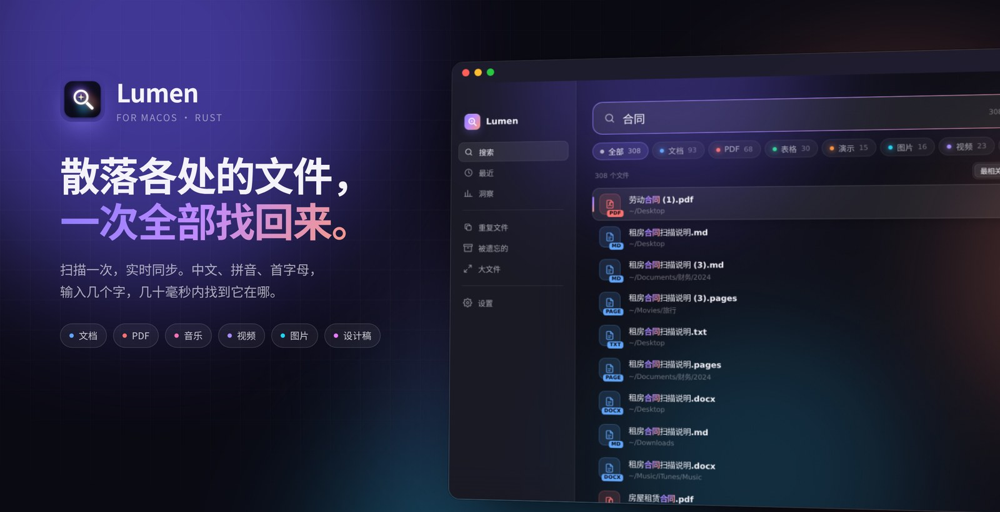
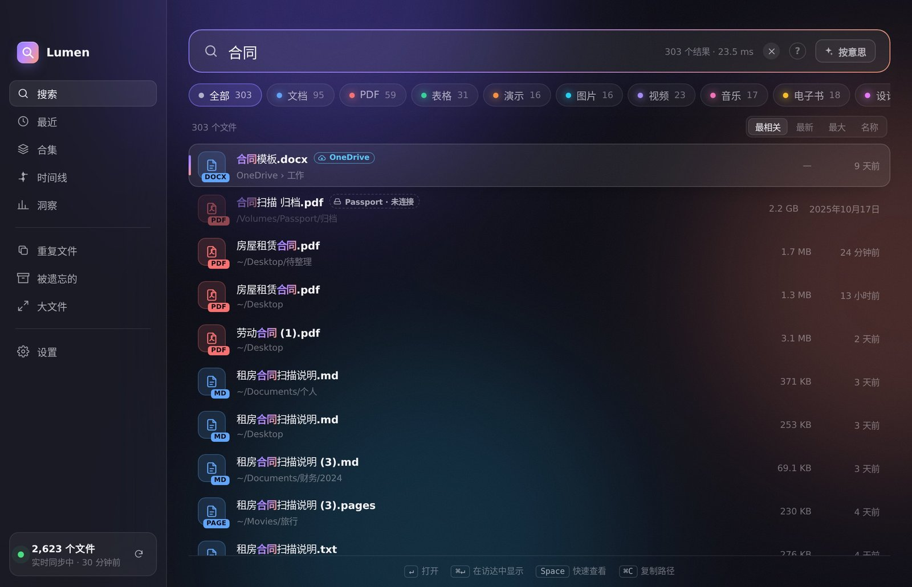
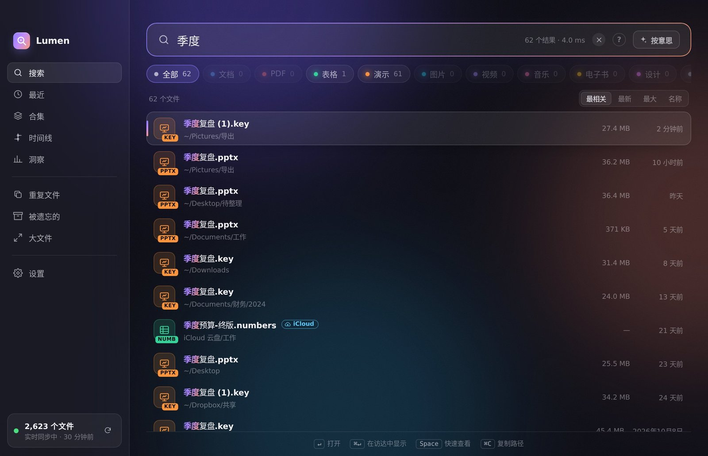
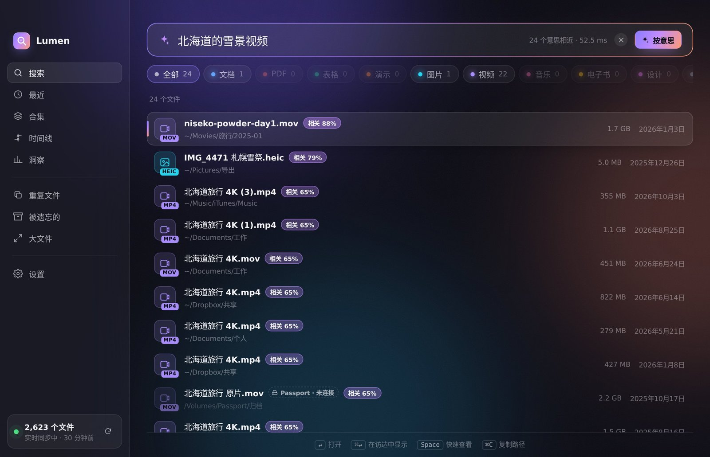
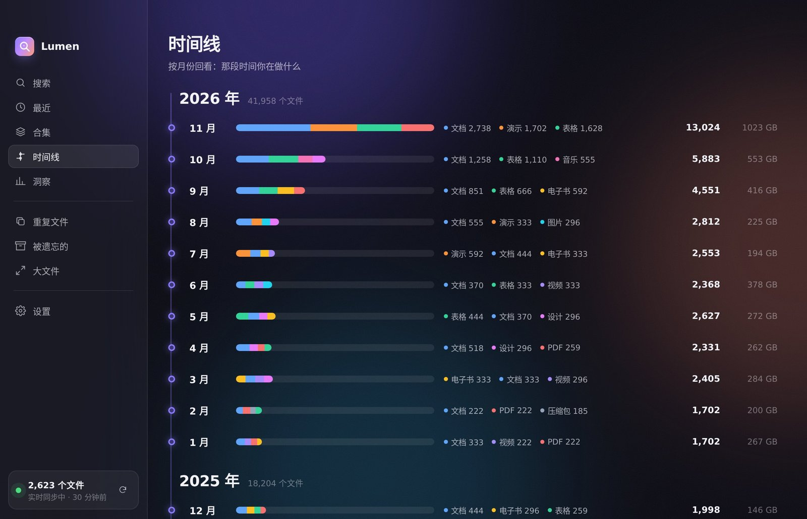
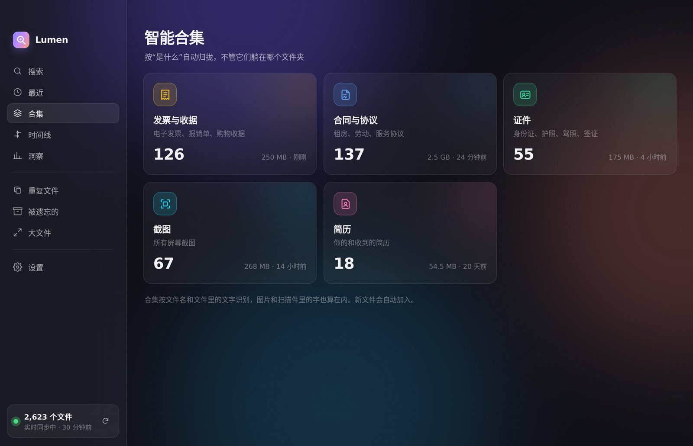
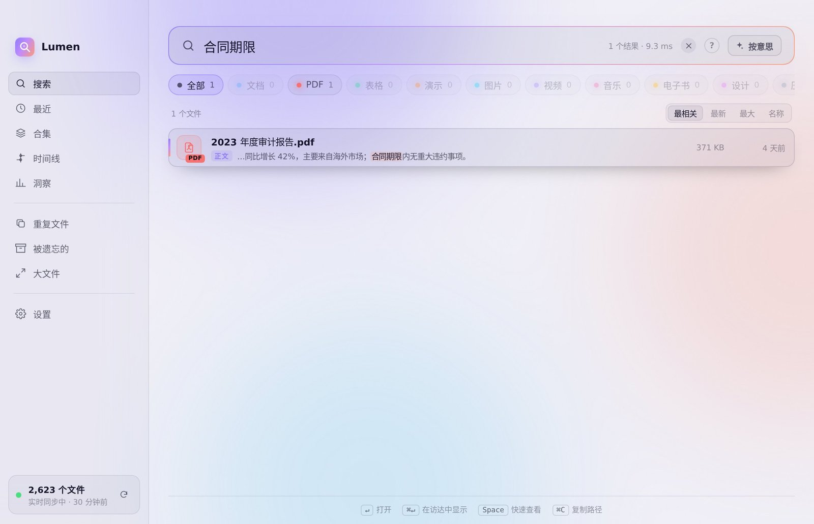
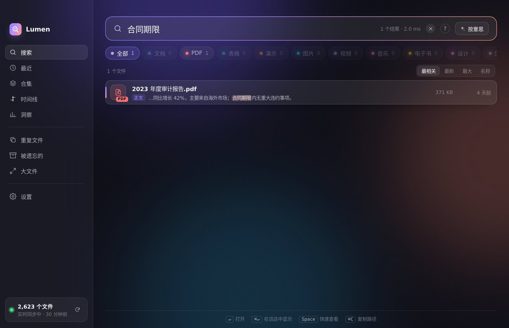

<p align="center">
  
</p>

<p align="center">
  <b>简体中文</b> · <a href="README.en.md">English</a>
</p>

<p align="center">
  
  
  
  
  
  
</p>

<h3 align="center">只记得名字里的两个字？拼音首字母也行。<br>连名字都忘了？说一句文件里写过的话。</h3>

<br>

<p align="center">
  
</p>

<br>

## ✦ v0.9 新增：各家云盘 · 不分重音

- **云盘同步文件夹** — Dropbox、OneDrive、Google Drive、Box、坚果云（新版云桥）等放在 `~/Library/CloudStorage` 的同步文件夹也会收录；`~/BaiduNetdisk`、`~/Nutstore Files` 等也标出所属云盘。每个结果带服务名小标签，没下载到本机的照样能搜到，Lumen 绝不为读取正文、OCR、查重而触发下载。设置 → 搜索能力 → 云盘同步文件夹。
- **`cloud:` 筛选** — `cloud:dropbox` `云盘:百度网盘` `cloud:any` `cloud:none`，只看（或排除）某个云盘。
- **不分重音** — `resume` 能找到 `Résumé.png`，`cafe` 能找到 `Café`；拼音和中文不受影响，旧索引会在后台自动补齐。
- **修复** — `lumen search … | head` 不再报 Broken pipe；早期 OCR 过的扫描 PDF 正确标为“图中”；首次查重时比对大文件可以随时停止。

<table>
<tr>
<td width="50%"><p align="center"><sub><b>云盘同步文件夹</b> · 每个结果标出所属云盘，没下载的也能搜到</sub></p></td>
<td width="50%"><p align="center"><sub><b>筛选速查</b> · 搜索栏点 ?，一行一个写法，点一下加进搜索</sub></p></td>
</tr>
</table>

## ✦ v0.8 新增：更顺手、更安静

- **首扫时就能搜** — 找到两千个文件后即可“先开始搜索”，扫描在后台继续；扫完给你几条用自己文件生成的示例搜索。
- **后台不抢电** — 读正文、识别图片文字都用后台优先级；用电池、低电量模式或你按了暂停时自动停下，插电后继续。
- **出错有按钮** — 缺权限、扫描中断、更新失败都附“去授权 / 重试”；索引文件损坏会自动重建。
- **常用的排前面** — 30 天内从 Lumen 打开过的文件在同一层级里优先。
- **自定义跳过** — 设置里添加文件夹名或 `*.log` 这样的类型。
- **30 万文件压测** — 带关键词的搜索只扫一遍，大索引下快了 2–20 倍。

## ✦ v0.7 新增：在哪儿都能叫出 Lumen · iCloud 云盘

<p align="center">
  
</p>

- **Raycast 与 Alfred** — Raycast 扩展（`integrations/raycast`）和 Alfred 工作流（每个版本附带 `Lumen.alfredworkflow`）：`lf 年终总结` 按名字/拼音/正文找，`la 北海道的雪景` 按意思找；↵ 打开、⌘↵ 在 Finder 中显示、⇧ 快速查看。
- **`lumen://` 链接** — `lumen://search?q=合同`、`lumen://ask?q=去年的租房合同`、`lumen://quick?q=发票`，在备忘录、网页或快捷指令的“打开 URL”里一点就搜。
- **快捷指令** — “打开 URL：lumen://search?q=…”唤起 Lumen；或“运行 Shell 脚本：`lumen --json search 发票`”把结果交给后续动作。
- **命令行随 App 安装** — `Lumen.app/Contents/MacOS/lumen`，用 Homebrew 安装时自动加入 PATH。
- **iCloud 云盘** — 云盘里的文件（包括没下载到本机的）也能搜到，标注“iCloud”；Lumen 不会为了读取正文、查重而触发下载。

## ✦ v0.6 新增：按意思搜索 · Homebrew 安装

<p align="center">
  
</p>

- **按意思搜索（测试版）** — 不记得文件名也没关系，直接描述："北海道的雪景视频"、"去年签的租房合同"。Lumen 用 macOS 提供的语言模型理解每个文件讲的是什么；本机缺中文模型时由系统从苹果下载一次，你的文件不会离开这台 Mac。搜索栏点 ✦ 或按 ⌘J 切换；关键词搜不到时也会提示你按意思再找一次。
- **Homebrew 一行安装** — `brew tap lyinet/lumen-finder https://github.com/lyinet/lumen-finder && brew install --cask lumen-finder`

## ✦ v0.5 新增：时间线 · 分享卡片 · 应用内更新

<p align="center">
  
</p>

- **时间线** — 按月份回看所有文件，每个月由哪些类型组成一眼可见；点进某个月再按类型筛。"去年 11 月我在忙什么"，一页答完。
- **分享卡片** — 洞察页一键生成竖版卡片（多少文件、各类型占比、两年没碰的大文件），保存到桌面就能发朋友圈、小红书。
- **应用内更新** — 新版本发布后弹出提示，点一下下载、校验签名、自动重启。只在你点击时安装，可在设置里关掉检查。

## ✦ v0.4 新增：智能合集 + 图片文字识别

<p align="center">
  
</p>

- **智能合集** — 发票与收据、合同与协议、证件、截图、简历，不管散在哪个文件夹，自动归拢到一处，新文件自动加入。
- **识别图片里的文字（OCR）** — 用 macOS 自带的 Vision 读取照片、截图和扫描版 PDF（简繁中、英、日、韩），拍下的发票、身份证扫描件也能按文字搜到。全程在本机。
- **繁體中文介面** — 系統語言為繁體中文（台灣、香港、澳門）時自動切換。

## ✦ v0.3 新增：像 Spotlight 一样随手一搜

<p align="center">
  
</p>

- **快速搜索小窗** — 按 `⌥ Space`，屏幕中间弹出搜索框；`↵` 打开，`⌘↵` 在访达中显示，`⌘Y` 快速查看，`⌘O` 把全部结果交给主窗口。点别处自动收起。
- **正文索引重写** — 中文按二字切分建索引：「合同」这类两字词从 71 ms 降到 **8 ms**，索引体积缩小 **40%**，首次读取快 25%。
- **开机启动** — 登录后安静待在菜单栏，不弹窗。
- **浅色 / 深色 / 跟随系统** — 可在设置里固定外观。

<table>
<tr>
<td width="50%"><p align="center"><sub><b>浅色外观</b> · 小窗</sub></p></td>
<td width="50%"><p align="center"><sub><b>浅色外观</b> · 主窗口</sub></p></td>
</tr>
</table>

## ✦ v0.2 新增：搜文件里写了什么

<p align="center">
  
</p>

- **正文搜索** — 读取 Word、PDF、Markdown、TXT、RTF、HTML、PPT、Excel、OpenDocument、EPUB 里的文字。输入"合同期限"，直接定位到写了这句话的审计报告，并显示原文片段。老 Windows 的 GBK 文本也能读。全部本机处理。
- **外置硬盘离线索引** — 移动硬盘、U 盘自动收录；拔掉后文件照样搜得到，标注「Passport · 未连接」。插回自动补扫。
- **重复文件一键清理** — 每组选一份保留，其余移到废纸篓（可在废纸篓"放回"），或一键清理全部。
- **菜单栏图标 + 自定义快捷键** — 点菜单栏随时呼出；在设置里录制任意组合键替换 ⌥ Space，冲突时提示。
- **完全磁盘访问引导** — 检测权限，一键跳到系统设置，避免逐个文件夹弹窗和漏扫。

<table>
<tr>
<td width="50%"><p align="center"><sub><b>重复文件</b> · 选保留哪份，其余进废纸篓</sub></p></td>
<td width="50%"><p align="center"><sub><b>设置</b> · 权限引导、正文搜索、外置硬盘、快捷键</sub></p></td>
</tr>
</table>

## ✦ 为什么是 Lumen

> Spotlight 什么都搜，结果里混着邮件、设置和网页建议；Finder 搜索要等，也不认拼音。
> Lumen 只回答一个问题：**你自己的文件在哪。**

<table>
<tr>
<td width="33%" valign="top">

### ⚡ 一次扫描，永远同步
并行遍历个人文件夹，12 万文件 **4.4 秒**建好索引。之后通过 FSEvents 实时增量，关机期间的变化启动时自动补齐。

</td>
<td width="33%" valign="top">

### 🀄 懂中文的搜索
任意子串匹配，`合同` 能找到《劳动合同扫描件》；**全拼** `hetong`、**首字母** `nzzj` 都行。

</td>
<td width="33%" valign="top">

### 🧹 只收你的文件
自动排除系统目录、资源库、应用、`.app`/照片图库、`node_modules`、`.git`、缓存与隐藏文件。

</td>
</tr>
<tr>
<td valign="top">

### ⌨️ 键盘优先
`⌥ Space` 全局呼出，`↑↓` 选择，`↵` 打开，`⌘↵` 在访达中显示，`Space` 快速查看，`⌘C` 复制路径。

</td>
<td valign="top">

### 🔍 一行筛选
`kind:pdf` `类型:视频` `in:Downloads` `cloud:dropbox` `>100mb` `after:2024-03` `"精确短语"`，自由组合。

</td>
<td valign="top">

### 🔒 完全离线
索引只存在你的 Mac 上。不上传、不收集任何数据；联网只有两处：检查新版本（可关闭），以及本机缺语言模型时让 macOS 从苹果下载一次。

</td>
</tr>
</table>

## ✦ 看一看

<table>
<tr>
<td width="50%"><p align="center"><sub><b>首次启动</b> · 扫什么、不扫什么，一眼看清</sub></p></td>
<td width="50%"><p align="center"><sub><b>扫描雷达</b> · 每个光点是一类被找到的文件</sub></p></td>
</tr>
<tr>
<td><p align="center"><sub><b>洞察</b> · 你的视频散落在多少个文件夹里？</sub></p></td>
<td><p align="center"><sub><b>外置硬盘</b> · 拔掉也能搜到，标注未连接</sub></p></td>
</tr>
</table>

<sub>截图为界面预览（模拟数据）。</sub>

## ✦ 搜索语法

| 写法 | 含义 |
|---|---|
| `合同` `hetong` `ht` | 名称或文件夹包含；拼音全拼 / 首字母；也匹配文档正文；不分重音（`resume` 找到 `Résumé`） |
| `name:合同` | 只匹配文件名，不搜正文 |
| `kind:pdf` `类型:音乐` | 按类型：文档 · 表格 · 演示 · PDF · 电子书 · 音乐 · 视频 · 图片 · 压缩包 · 设计 |
| `ext:key` | 按扩展名 |
| `in:Downloads` | 路径中包含 |
| `cloud:dropbox` `云盘:百度网盘` | 某个云盘里的文件：`icloud` `dropbox` `onedrive` `gdrive` `box` `baidu` `nutstore`，或 `~/Library/CloudStorage` 中任一文件夹名开头；`cloud:any` 全部云盘，`cloud:none` 排除云盘 |
| `>100mb` `<2gb` | 按大小 |
| `after:2024-03` `before:2025` | 按修改时间 |
| `"meeting notes"` | 精确短语 |

别名：`type:` / `is:` 同 `kind:`，`folder:` 同 `in:`，`since:` 同 `after:`，`until:` 同 `before:`；繁体写法 `類型:` `檔名:` `副檔名:` `雲端:` `之後:` `之前:` 也能用。搜索框右侧的 **?** 按钮随时列出这些写法。

## ✦ 安装

**Homebrew（推荐）**

```bash
brew tap lyinet/lumen-finder https://github.com/lyinet/lumen-finder
brew install --cask lumen-finder
```

或从 [Releases](https://github.com/lyinet/lumen-finder/releases/latest) 下载 DMG。它还没有经过苹果公证，第一次打开会被 macOS 拦下：到 **系统设置 → 隐私与安全性** 点 **仍要打开**（详见[常见问题](#-常见问题)）。用 Homebrew 安装没有这一步。之后新版本会在应用内提示更新。需要 macOS 11 或更高版本。

**从源码构建**（约 5 分钟，需要 macOS 11+ 和 Xcode 命令行工具）

```bash
xcode-select --install
curl https://sh.rustup.rs -sSf | sh
cargo install tauri-cli --version "^2" --locked
git clone https://github.com/lyinet/lumen-finder.git && cd lumen-finder
```

App 里打包了两个辅助程序（`tauri.conf.json` 的 `externalBin`），仓库里没有现成文件：`lumen-ocr`（Swift 写的 Apple Vision 文字识别和语义向量）和 `lumen`（命令行）。先按 CI 的做法把它们编译到 `app/src-tauri/binaries/`，文件名带目标三元组。

只给自己这台 Mac 用（`cargo tauri dev` 或单架构打包）：

```bash
T=$(rustc -vV | sed -n 's/^host: //p')          # aarch64-apple-darwin 或 x86_64-apple-darwin
mkdir -p app/src-tauri/binaries
swiftc -O -target "$(uname -m)-apple-macos11" app/ocr/main.swift -o "app/src-tauri/binaries/lumen-ocr-$T"
cargo build --release -p lumen-cli
cp target/release/lumen "app/src-tauri/binaries/lumen-$T"

cd app/src-tauri
cargo tauri dev                                  # 开发运行
cargo tauri build --config '{"bundle":{"createUpdaterArtifacts":false}}'   # 打包 .app + .dmg
```

通用版（Apple Silicon + Intel），与 `.github/workflows/build.yml` 相同：

```bash
rustup target add aarch64-apple-darwin x86_64-apple-darwin
mkdir -p app/src-tauri/binaries
for arch in arm64 x86_64; do
  swiftc -O -target $arch-apple-macos11 app/ocr/main.swift -o /tmp/lumen-ocr-$arch
done
lipo -create /tmp/lumen-ocr-arm64 /tmp/lumen-ocr-x86_64 -output /tmp/lumen-ocr
for t in aarch64-apple-darwin x86_64-apple-darwin; do
  cargo build --release -p lumen-cli --target $t
done
lipo -create target/aarch64-apple-darwin/release/lumen target/x86_64-apple-darwin/release/lumen -output /tmp/lumen
for t in universal-apple-darwin aarch64-apple-darwin x86_64-apple-darwin; do
  cp /tmp/lumen-ocr app/src-tauri/binaries/lumen-ocr-$t
  cp /tmp/lumen app/src-tauri/binaries/lumen-$t
done
cd app/src-tauri
cargo tauri build --target universal-apple-darwin --config '{"bundle":{"createUpdaterArtifacts":false}}'
```

`createUpdaterArtifacts:false` 跳过应用内更新包的签名（那需要项目自己的更新私钥 `TAURI_SIGNING_PRIVATE_KEY`）。没有苹果证书时，设置 `APPLE_SIGNING_IDENTITY=-` 即可像正式版一样做临时（ad-hoc）签名。

想一次扫全，请在 **系统设置 → 隐私与安全性 → 完全磁盘访问权限** 中允许 Lumen。

<details>
<summary><b>不装 Rust，先在浏览器里看界面</b></summary>

```bash
cd app/ui && python3 -m http.server 8765
# 打开 http://localhost:8765/#first   （#insights  #dupes  #q=合同）
```
</details>

<details>
<summary><b>命令行</b>（与 App 共用索引）</summary>

```bash
cargo run -p lumen-cli -- scan ~          # 扫描后自动读取正文
cargo run -p lumen-cli -- search 合同 kind:pdf
cargo run -p lumen-cli -- ask 北海道的雪景视频   # 按意思搜索（需要已安装 Lumen.app）
cargo run -p lumen-cli -- stats
cargo run -p lumen-cli -- dupes
```
</details>

## ✦ 常见问题

<details>
<summary><b>macOS 提示“无法打开 Lumen”或“Apple 无法验证”</b></summary>

Lumen 还没有经过苹果公证。用 Homebrew 安装可以跳过这一步（cask 会清除下载隔离标记）。用 DMG 的话：把 Lumen 拖进“应用程序”后先打开一次，被拦下时点 **完成**，然后打开 **系统设置 → 隐私与安全性**，滚动到 **安全性**，在关于 Lumen 的提示旁点 **仍要打开**（尝试打开后约一小时内会显示），再用密码或触控 ID 确认。只需一次；之后的应用内更新会正常打开。macOS 14 及更早版本也可以按住 Control 点按 → 打开。
</details>

<details>
<summary><b>完全磁盘访问权限：为什么需要，更新后怎么办</b></summary>

没有它，macOS 会对桌面、文稿、下载、iCloud 云盘和外置硬盘逐个弹窗，部分文件夹也会漏扫。打开 **系统设置 → 隐私与安全性 → 完全磁盘访问权限**，打开 Lumen 的开关；列表里没有 Lumen 时点 **+**（或从“应用程序”把它拖进去）。Lumen 设置里有按钮直接打开这一页，并一步步引导。

由于 Lumen 还没有用 Apple Developer ID 签名，macOS 可能把更新后的 Lumen 当成一个新应用。如果更新后 Lumen 又来要权限，或者有文件夹搜不到：在完全磁盘访问权限列表里选中 Lumen，点 **–** 移除，再点 **+** 重新加入，然后重新打开 Lumen。
</details>

<details>
<summary><b>日志在哪里？</b></summary>

`~/Library/Logs/app.lumen.desktop/Lumen.log`。**设置 → 日志 → 在访达中显示日志** 会直接选中它。日志记录 Lumen 做了什么和出过的错，可能包含文件和文件夹路径，附到 Issue 之前可以先看一眼。
</details>

<details>
<summary><b>怎样彻底卸载？</b></summary>

Homebrew：`brew uninstall --zap --cask lumen-finder` 会删除应用、`lumen` 命令和下表中的全部内容。

手动：先关掉 **设置 → 开机时启动**，从菜单栏退出 Lumen，把“应用程序”里的 Lumen 移到废纸篓，再删除：

| 路径 | 内容 |
|---|---|
| `~/Library/Application Support/app.lumen.desktop` | 索引（`index.db`）和设置（`config.json`） |
| `~/Library/Logs/app.lumen.desktop` | 日志 |
| `~/Library/Caches/app.lumen.desktop` | 缓存 |
| `~/Library/WebKit/app.lumen.desktop` | 网页视图数据 |
| `~/Library/Preferences/app.lumen.desktop.plist` | macOS 偏好设置 |
| `~/Library/LaunchAgents/Lumen.plist` | 开机启动项（仅在开启过时存在） |

Lumen 从不改动你的文件，其他地方不需要清理。
</details>

<details>
<summary><b>Lumen 会联网吗？</b></summary>

只在检查更新时联网：从本仓库的 GitHub Releases 读取一个很小的 `latest.json`，只有你点了安装才会下载更新。可在 **设置 → 自动检查更新** 关闭。没有统计、没有遥测，文件和索引从不离开这台 Mac。另外，开启按意思搜索时（macOS 14+），macOS 可能从苹果下载一次本机语言模型，这是 macOS 自己的下载。
</details>

## ✦ 架构

```
app/ui              原生 JS + CSS，零构建；浏览器中自动使用模拟数据
app/src-tauri       Tauri 2 外壳：命令、事件、菜单栏、可改快捷键、废纸篓、毛玻璃窗口
crates/lumen-core   引擎：排除规则 · 并行扫描 · SQLite WAL + FTS5 trigram
                    · 拼音索引 · 增量（generation）· FSEvents 监听 · 重复文件（BLAKE3）
                    · 正文提取（docx/pptx/xlsx/pdf/epub/…）+ 正文 FTS · 外置卷离线保留
crates/lumen-cli    命令行
```

设计取舍与性能数据见 [docs/ARCHITECTURE.md](docs/ARCHITECTURE.md)。

## ✦ 路线图

- [x] 全盘扫描 + 实时增量、中文/拼音搜索、筛选语法、洞察、重复文件
- [ ] 签名公证 DMG（需 Apple Developer 账号）
- [x] 菜单栏入口 · 自定义呼出快捷键 · 完全磁盘访问引导 <sub>v0.2</sub>
- [x] 外置硬盘离线索引（"Passport · 未连接"）<sub>v0.2</sub>
- [x] 重复文件一键移到废纸篓 <sub>v0.2</sub>
- [x] **正文搜索** PDF / Word / Markdown / PPT / Excel / EPUB <sub>v0.2</sub>
- [x] 图片与扫描件 **OCR**（本地 Apple Vision） <sub>v0.4</sub>
- [x] 快速搜索小窗 · 开机自启 · 浅色主题 · 二字词正文索引 <sub>v0.3</sub>
- [x] 应用内自动更新 <sub>v0.5</sub> · 时间线 · 分享卡片 <sub>v0.5</sub>
- [x] Homebrew cask <sub>v0.6</sub>
- [x] 智能合集：发票、合同、证件、截图、简历 <sub>v0.4</sub>
- [x] 本地语义搜索："北海道的雪景视频" <sub>v0.6 测试版</sub>

完整计划见 [docs/PRODUCT.md](docs/PRODUCT.md)。

## ✦ 参与

欢迎 Issue 和 PR。引擎测试在 Linux / macOS 都能跑：

```bash
cargo test --workspace
```

<br>

<p align="center"><sub>MIT License · Made with Rust 🦀 and a lot of 毛玻璃</sub></p>
